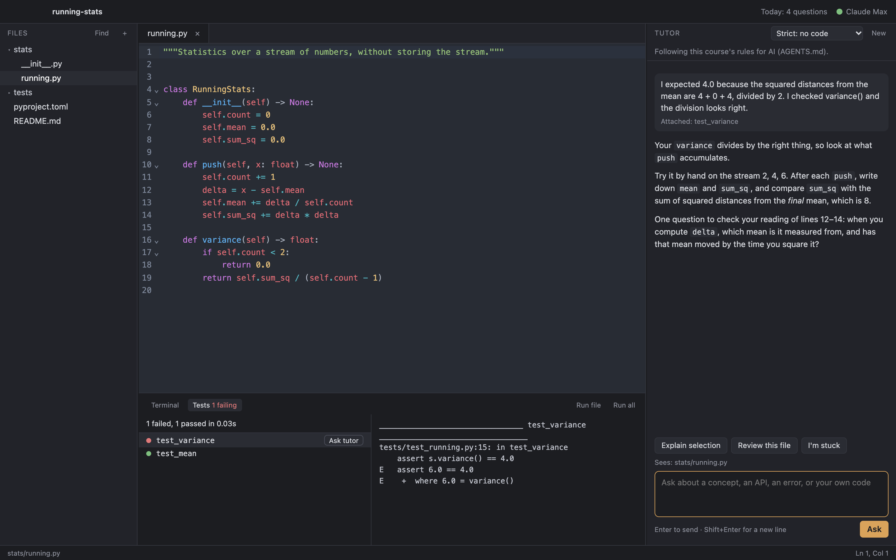

# Longhand

[](https://github.com/wastella/longhand/actions/workflows/ci.yml)
[](LICENSE)

A quiet code editor for students. You write every line; the AI is a read-only tutor that answers
like a teaching assistant in office hours.



Most AI editors are built to write code for you. That is the wrong tool when the point of the
work is learning to write it yourself. Longhand keeps the parts of AI help that support learning
(explaining concepts, looking up APIs, explaining errors, reviewing what you wrote) and leaves out
the parts that replace it.

> **Status:** in development, not yet released. macOS only. See the [roadmap](#roadmap) for what
> is missing.

## What it does

- **Editor, file tree, terminal and test panel.** Syntax highlighting, find in files, ordinary
  completion from the language and the open file. No AI autocomplete and no agent mode.
- **A tutor that cannot touch your code.** It can read the open folder. It cannot edit files or
  run commands, because it is started without those tools.
- **Office-hours behaviour.** Direct answers for lookups (what a function does, what an error
  means). Questions and sanity checks for debugging. Reviews as observations tied to line ranges,
  never a rewritten file.
- **Help starts from your own attempt.** "Ask tutor" on a failing test attaches the traceback and
  asks what you expected first.
- **Course rules respected.** If the folder has an `AGENTS.md` or `CLAUDE.md` with rules for AI
  assistants, as some courses now ship, the tutor follows it.
- **Two policies per folder.** _Strict_: no code in answers. _Guided_: short examples on toy or
  analogous problems. Code beyond the limit is hidden behind a **Reveal (logged)** button.
- **Your own record.** Questions, test runs and reveals are written to `.longhand/log.jsonl` in
  the folder, with today's counts in the title bar. It never leaves your machine.

## Install

There is no packaged release yet. For now, [build from source](#build-from-source).

For the tutor, install [Claude Code](https://claude.com/claude-code) and log in once by running
`claude` in a terminal. Longhand shows these steps itself if the tutor is not connected. The
editor, terminal and tests work without it.

The test panel runs `uv run pytest` when the folder has a `pyproject.toml`, and
`python3 -m pytest` otherwise.

## How the tutor is constrained

Longhand does not talk to a model directly and never handles your Claude credentials. It runs the
`claude` command-line tool you installed, on your own subscription, with:

- only the `Read`, `Glob` and `Grep` tools, so there is no tool that writes or executes;
- your personal Claude Code settings, plugins and MCP servers switched off for that run;
- a tutor prompt ([`src-tauri/src/tutor-prompt.md`](src-tauri/src/tutor-prompt.md)) plus the
  folder's course rules, if any.

The read-only limit is enforced by the harness: if any other tool is offered, Longhand stops the
run. The no-code policy is weaker. It is a prompt plus a check in the interface that hides code
blocks over the policy's limit. A determined student can get around it, and an unrestricted
chatbot is always one window away. Treat the policies as a commitment you chose, not a lock.

## Privacy

- Files the tutor reads, and your questions, go to Anthropic through your own Claude account,
  under the terms of that account.
- Longhand has no server, no telemetry and no accounts of its own.
- The usage log and per-folder settings stay in `.longhand/` inside the folder. Add it to
  `.gitignore` if you do not want to commit it.

## Build from source

Requires [Node.js](https://nodejs.org) 22+, [Rust](https://rustup.rs) stable, and Xcode's
command-line tools.

```bash
git clone https://github.com/wastella/longhand
cd longhand
npm install
npm run dev      # run the app
npm run build    # release build in src-tauri/target/release/bundle/
npm test         # interface tests (headless Chrome) and backend tests
```

## Roadmap

Not built yet, roughly in order:

- Python language server: errors underlined, go to definition, hover documentation
- Signed and notarized releases with automatic updates
- A measured leak rate for the tutor's policies, from a published set of adversarial prompts
- An API-key option for people without a Claude subscription
- Tensor shapes on hover for jaxtyping-annotated code
- Linux and Windows builds
- A debugger, and running on a remote machine beyond `ssh` in the terminal

Deliberately out of scope: AI autocomplete, agents that edit your files, and "fix it" buttons.

## Contributing

Contributions are welcome. Start with [CONTRIBUTING.md](CONTRIBUTING.md), which covers setup,
tests and what kinds of changes fit the project. Security issues go through
[SECURITY.md](SECURITY.md).

## License

[MIT](LICENSE)
